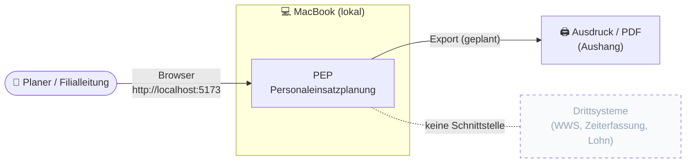
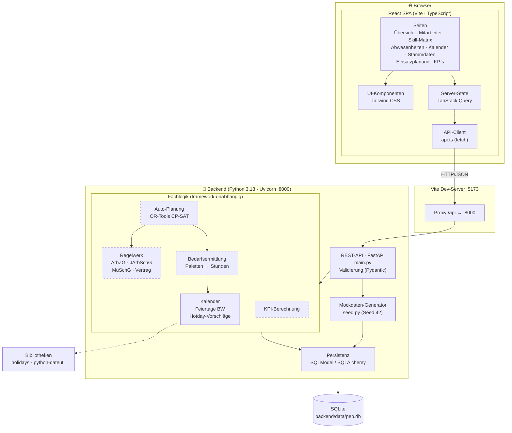
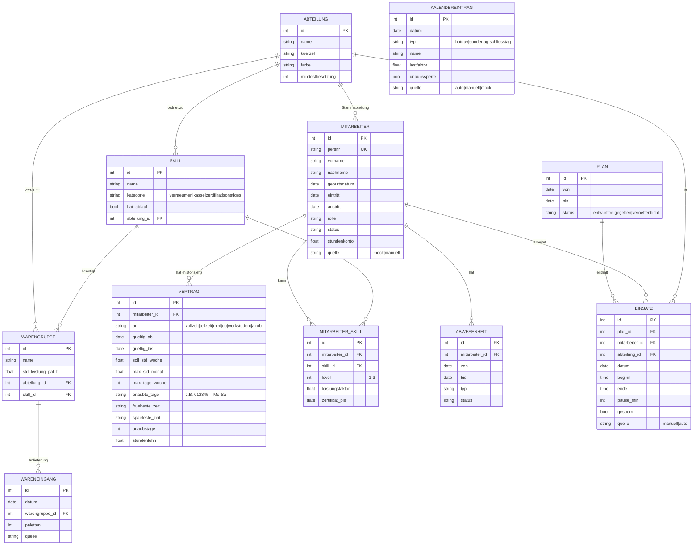
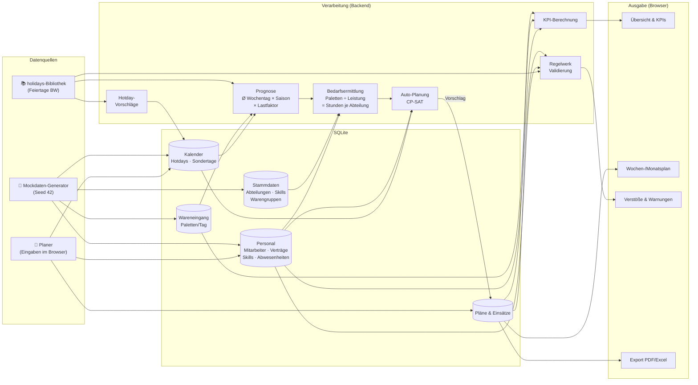
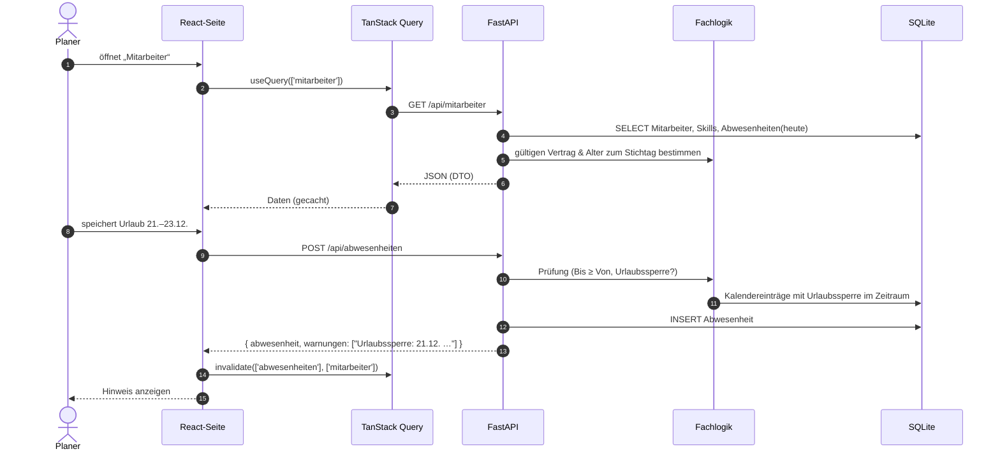
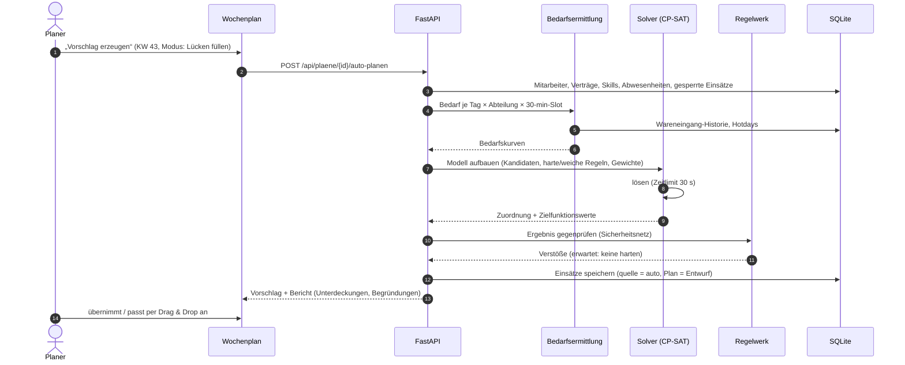
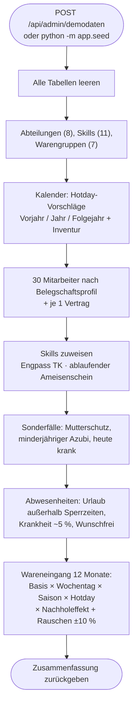

# PEP – Technisches Konzept & Systemdokumentation

| | |
|---|---|
| **System** | PEP – Personaleinsatzplanung für eine Discounter-Filiale (Typ Lidl) |
| **Version** | 0.1 (Dokumentationsstand 13.10.2026) |
| **Betrieb** | lokal auf einem MacBook, Single-User |
| **Fachkonzept** | [`../KONZEPT.md`](../KONZEPT.md) |
| **Schnittstellen zu Drittsystemen** | keine (siehe Kapitel 10) |

> Dieses Dokument ist gleichzeitig die technische Dokumentation des Systems. Es wird bei jeder Architekturänderung mitgepflegt. Abschnitte mit dem Status 🟡 *geplant* beschreiben den Zielzustand, Abschnitte mit ✅ *umgesetzt* den aktuellen Code.

---

## Inhalt

1. [Rahmenbedingungen & Architekturziele](#1-rahmenbedingungen--architekturziele)
2. [Architekturüberblick](#2-architekturüberblick)
3. [Technologie-Stack](#3-technologie-stack)
4. [Komponenten](#4-komponenten)
5. [Datenmodell](#5-datenmodell)
6. [Datenflüsse](#6-datenflüsse)
7. [API-Spezifikation](#7-api-spezifikation)
8. [Regelwerk (Arbeitszeitrecht)](#8-regelwerk-arbeitszeitrecht)
9. [Auto-Planung (Solver)](#9-auto-planung-solver)
10. [Schnittstellen](#10-schnittstellen)
11. [Sicherheit & Datenschutz](#11-sicherheit--datenschutz)
12. [Betrieb, Start & Backup](#12-betrieb-start--backup)
13. [Qualitätssicherung](#13-qualitätssicherung)
14. [Verzeichnisstruktur](#14-verzeichnisstruktur)
15. [Architekturentscheidungen (ADR)](#15-architekturentscheidungen-adr)
16. [Umsetzungsstand](#16-umsetzungsstand)

---

## 1. Rahmenbedingungen & Architekturziele

### 1.1 Rahmenbedingungen

| Thema | Festlegung |
|---|---|
| Laufzeitumgebung | macOS, lokal; kein Server, keine Cloud |
| Nutzer | eine Person (Filialleitung / Planer) im Browser auf demselben Rechner |
| Betrieb der Filiale | Mo–Sa, keine Sonn- und Feiertagsarbeit |
| Bundesland | Baden-Württemberg (Feiertagskalender) |
| Arbeitszeiten | flexibel, 15-Minuten-Raster |
| Datenbasis | ausschließlich **Mockdaten** (Mitarbeiter, Wareneingang, KPIs) |
| Drittsysteme | **keine** Schnittstellen (kein WWS, keine Zeiterfassung, keine Lohnbuchhaltung) |
| Rechtsrahmen | ArbZG, JArbSchG, MuSchG; kein Tarifvertrag, keine Betriebsvereinbarung |

### 1.2 Architekturziele (priorisiert)

1. **Korrektheit der Rechtsregeln**: Das Regelwerk ist isoliert, deterministisch und vollständig durch Tests abgedeckt.
2. **Einfacher Betrieb**: Start mit einem Befehl, eine Datenbankdatei, keine Infrastruktur.
3. **Erweiterbarkeit**: Spätere Schnittstellen (z. B. Import echter Daten) dürfen den Kern nicht verändern.
4. **Nachvollziehbarkeit**: Jeder Planvorschlag und jeder Regelverstoß muss erklärbar sein („warum ist diese Schicht rot?“).
5. **Reproduzierbarkeit**: Mockdaten sind deterministisch (fester Seed), damit Tests und Vorführungen gleich ablaufen.

---

## 2. Architekturüberblick

### 2.1 Kontextsicht

PEP ist ein abgeschlossenes System. Der Planer arbeitet im Browser, alle Daten liegen lokal.



### 2.2 Architekturschaubild (Bausteinsicht)

Klassische Drei-Schichten-Architektur: React-Single-Page-App ↔ REST-API (FastAPI) ↔ SQLite. Fachlogik (Regelwerk, Bedarf, Solver) liegt im Backend als eigenständige Python-Module ohne Abhängigkeit zur Web-Schicht.



*Gestrichelt = geplant (Phase 3–5), durchgezogen = umgesetzt.*

### 2.3 Schichten & Verantwortlichkeiten

| Schicht | Verantwortung | Darf **nicht** |
|---|---|---|
| **Frontend** | Darstellung, Eingabe, Drag & Drop, sofortiges visuelles Feedback | Rechtsregeln selbst entscheiden (zeigt nur Ergebnisse des Backends an) |
| **API** | HTTP, Eingabevalidierung, Transaktionen, Zusammenbau der DTOs | Fachlogik enthalten, die über das Laden/Speichern hinausgeht |
| **Fachlogik** | Regeln, Bedarf, Kalender, Solver, KPIs als reine Funktionen | auf HTTP, FastAPI oder die Session-Verwaltung zugreifen |
| **Persistenz** | Tabellen, Abfragen | Geschäftsregeln enthalten |

---

## 3. Technologie-Stack

| Bereich | Technologie | Version | Begründung |
|---|---|---|---|
| Frontend-Framework | React | 19 | Vorgabe; großes Ökosystem |
| Sprache Frontend | TypeScript | 6.0 | Typsicherheit gegen das API-Schema |
| Build / Dev-Server | Vite | 8 | schneller Start, Proxy für `/api` |
| Styling | Tailwind CSS | 4 | schnelle, konsistente UI ohne eigenes CSS-Framework |
| Server-State | TanStack Query | 5 | Caching, Invalidierung nach Mutationen |
| Routing | React Router | 7 | Seitennavigation |
| Datumslogik | date-fns (de-Locale) | 4 | deutsche Formate, Kalenderrechnung |
| Diagramme | Recharts | 3 | KPI-Charts |
| Drag & Drop | dnd-kit | – | 🟡 geplant für Wochen-/Monatsplan |
| Backend-Sprache | Python | 3.13 | beste Unterstützung für OR-Tools |
| Web-Framework | FastAPI | 0.143 | automatische Validierung, OpenAPI-Doku unter `/docs` |
| App-Server | Uvicorn | 0.54 | ASGI-Server |
| ORM | SQLModel (SQLAlchemy + Pydantic) | 0.0.48 | ein Modell für DB und API |
| Datenbank | SQLite | 3 | dateibasiert, keine Installation |
| Feiertage | holidays, python-dateutil | 0.106 | Feiertage je Bundesland, Osterformel |
| Solver | Google OR-Tools (CP-SAT) | – | 🟡 geplant; Constraint-Optimierung für Schichtplanung |
| Tests | pytest, FastAPI TestClient | – | Backend-Tests; 🟡 Vitest/Playwright geplant |

---

## 4. Komponenten

### 4.1 Frontend (`frontend/src`)

| Baustein | Datei(en) | Aufgabe |
|---|---|---|
| App-Shell & Navigation | `App.tsx` | Seitenleiste, Routing, Button „Demodaten zurücksetzen“ |
| API-Client | `api.ts` | `fetch`-Wrapper, Fehlerübersetzung, TypeScript-Typen, Beschriftungen |
| UI-Bibliothek | `components/ui.tsx` | Button, Card, Modal, Field, Badge, Datumsformatierung |
| Seiten | `pages/*.tsx` | je ein Modul aus dem Fachkonzept |

Zustandsverwaltung: **kein globaler Client-Store**. Serverdaten liegen im Cache von TanStack Query (Schlüssel z. B. `['mitarbeiter']`). Nach jeder Mutation werden die betroffenen Schlüssel invalidiert. Formularzustand ist lokaler React-State.

### 4.2 Backend (`backend/app`)

| Modul | Aufgabe | Status |
|---|---|---|
| `main.py` | REST-Endpunkte, Pydantic-Eingabemodelle, DTO-Aufbau | ✅ |
| `models.py` | SQLModel-Tabellen (Kapitel 5) | ✅ |
| `db.py` | Engine, Session-Factory, `PEP_DB`-Umgebungsvariable | ✅ |
| `kalender.py` | Feiertage BW, Werktagsprüfung, Hotday-Vorschläge | ✅ |
| `seed.py` | deterministischer Mockdaten-Generator | ✅ |
| `regeln/` | Regelwerk als reine Funktionen | 🟡 Phase 3 |
| `bedarf.py` | Prognose und Bedarfsermittlung | 🟡 Phase 4 |
| `kpi.py` | KPI-Berechnungen | 🟡 Phase 4 |
| `solver/` | CP-SAT-Modell, Kandidatengenerierung, Ergebnisbericht | 🟡 Phase 5 |
| `export/` | PDF/Excel/CSV | 🟡 Phase 6 |

---

## 5. Datenmodell

### 5.1 ER-Diagramm



`PLAN` und `EINSATZ` sind 🟡 geplant (Phase 3), alle anderen Tabellen sind umgesetzt.

### 5.2 Modellierungsentscheidungen

- **Feiertage werden nicht gespeichert**, sondern bei jeder Anfrage aus `holidays` berechnet. Gespeichert werden nur Abweichungen (Hotdays, Sondertage, Schließtage).
- **Verträge sind historisiert** (`gueltig_ab`/`gueltig_bis`). Ein neuer Vertrag beendet den offenen Vorgänger automatisch zum Vortag. Der gültige Vertrag wird immer über das Stichtagsdatum ermittelt.
- **Alter / Minderjährigkeit** wird nicht gespeichert, sondern zum Stichtag aus `geburtsdatum` berechnet (wichtig für JArbSchG).
- **Herkunftsfeld `quelle`** auf Mitarbeitern, Kalendereinträgen und Wareneingängen trennt Mock-, automatisch erzeugte und manuelle Daten.
- **Zeiten** werden als `HH:MM`-Strings im 15-Minuten-Raster gespeichert; die Rechenlogik arbeitet intern in Minuten seit Mitternacht.

---

## 6. Datenflüsse

### 6.1 Gesamtdatenfluss

Wie Daten entstehen, verarbeitet werden und als Plan bzw. KPI wieder herauskommen:



### 6.2 Datenfluss Lesen/Schreiben (Request-Zyklus)



### 6.3 Datenfluss Auto-Planung 🟡



### 6.4 Datenfluss Mockdaten-Generierung



---

## 7. API-Spezifikation

Basis-URL: `http://localhost:8000/api`. Die interaktive OpenAPI-Dokumentation erzeugt FastAPI automatisch unter `http://localhost:8000/docs`.

| Methode | Pfad | Zweck | Status |
|---|---|---|---|
| GET | `/stammdaten` | Abteilungen, Skills, Warengruppen | ✅ |
| PUT | `/abteilungen/{id}` | Abteilung ändern | ✅ |
| PUT | `/warengruppen/{id}` | Leistungswert ändern | ✅ |
| GET | `/mitarbeiter` | Liste inkl. gültigem Vertrag, Skills, Abwesenheit heute | ✅ |
| GET | `/mitarbeiter/{id}` | Detail inkl. Vertragshistorie und Abwesenheiten | ✅ |
| POST | `/mitarbeiter` | anlegen (mit Erstvertrag); 409 bei doppelter Personalnummer | ✅ |
| PUT | `/mitarbeiter/{id}` | Stammdaten ändern | ✅ |
| POST | `/mitarbeiter/{id}/vertraege` | neuer Vertrag, beendet den Vorgänger | ✅ |
| PUT | `/vertraege/{id}` | Vertrag korrigieren | ✅ |
| PUT | `/mitarbeiter/{id}/skills` | Skill-Liste vollständig ersetzen | ✅ |
| GET | `/abwesenheiten?von&bis[&mitarbeiter_id]` | Abwesenheiten im Zeitraum | ✅ |
| POST/PUT/DELETE | `/abwesenheiten[/{id}]` | pflegen; Antwort enthält `warnungen` | ✅ |
| GET | `/kalender?jahr` | Feiertage (berechnet) + Einträge | ✅ |
| POST/PUT/DELETE | `/kalender/eintraege[/{id}]` | Hotdays/Sondertage pflegen | ✅ |
| POST | `/kalender/hotdays-vorschlagen?jahr` | automatische Hotdays neu erzeugen (manuelle bleiben) | ✅ |
| GET | `/dashboard` | Kennzahlen der Übersichtsseite | ✅ |
| POST | `/admin/demodaten` | Mockdaten neu erzeugen | ✅ |
| GET | `/kpi/anlieferung`, `/kpi/abdeckung` | KPI-Zeitreihen | 🟡 |
| GET | `/bedarf?von&bis` | Bedarfskurven | 🟡 |
| CRUD | `/plaene`, `/plaene/{id}/einsaetze` | Pläne und Einsätze | 🟡 |
| POST | `/plaene/{id}/validieren` | Liste der Regelverstöße | 🟡 |
| POST | `/plaene/{id}/auto-planen` | Solver-Vorschlag | 🟡 |
| GET | `/plaene/{id}/export?format=pdf\|xlsx\|csv` | Export | 🟡 |

**Konventionen**
- JSON, Datumswerte im ISO-Format (`2026-10-13`), Zeiten als `HH:MM`.
- Fehler: HTTP-Status + `{"detail": "<deutsche Meldung>"}`; Validierungsfehler 422.
- Fachliche Warnungen, die das Speichern nicht verhindern (z. B. Urlaubssperre), kommen im Feld `warnungen` einer 200-Antwort.

---

## 8. Regelwerk (Arbeitszeitrecht) 🟡

### 8.1 Aufbau

Jede Regel ist eine reine Funktion mit derselben Signatur:

```python
def regel(kontext: PlanKontext, mitarbeiter_id: int) -> list[Verstoss]
```

```python
@dataclass
class Verstoss:
    regel: str             # z. B. "ARBZG_5_RUHEZEIT"
    schwere: str           # "hart" | "weich"
    mitarbeiter_id: int
    datum: date
    einsatz_ids: list[int]
    meldung: str           # „Ruhezeit nur 9,5 h nach Spätschicht am 14.10.“
```

`PlanKontext` enthält die Einsätze des Prüfzeitraums **plus Puffer** (Vorwoche für Ruhezeiten, 24 Wochen für den 8-h-Durchschnitt), Verträge, Abwesenheiten, Feiertage und Regelparameter. Dadurch funktionieren dieselben Funktionen bei der Live-Validierung, im Validierungs-Endpunkt und als Gegenprüfung nach dem Solver.

### 8.2 Regelkatalog

| Code | Regel | Parameter (Default) | Schwere |
|---|---|---|---|
| `ARBZG_3_TAG` | max. Arbeitszeit pro Tag | 10 h absolut | hart |
| `ARBZG_3_SCHNITT` | Ø ≤ 8 h/Werktag über 24 Wochen | 8 h, 24 Wochen | hart (Warnung ab 7,5 h) |
| `ARBZG_4_PAUSE` | Pause > 6 h: 30 min, > 9 h: 45 min | 6 h/30, 9 h/45 | hart |
| `ARBZG_5_RUHEZEIT` | Ruhezeit zwischen Einsätzen | 11 h | hart |
| `ARBZG_9_SONNTAG` | keine Arbeit an Sonn- und Feiertagen | – | hart |
| `JARBSCHG` | Minderjährige: max. 8 h/Tag, 40 h/Woche, 5 Tage, 12 h Ruhe, 6–20 Uhr | Alter < 18 | hart |
| `MUSCHG` | keine Einplanung bei Status Mutterschutz | – | hart |
| `VERTRAG_TAGE` | erlaubte Wochentage, max. Tage pro Woche | aus Vertrag | hart |
| `VERTRAG_ZEITFENSTER` | früheste/späteste Zeit | aus Vertrag | hart |
| `VERTRAG_MINIJOB` | max. Monatsstunden | 43 h | hart |
| `VERTRAG_SOLL` | Abweichung von den Soll-Wochenstunden | ±10 % | weich |
| `ABWESENHEIT` | keine Einplanung während genehmigter Abwesenheit | – | hart |
| `SKILL` | Skill für die Abteilung vorhanden | – | hart |
| `ZERTIFIKAT` | Zertifikat zum Einsatzdatum gültig | – | hart |
| `FAIRNESS_SAMSTAG` | gleichmäßige Verteilung der Samstage | – | weich |

Die Parameter liegen in einer Tabelle `regelparameter` und lassen sich ohne Codeänderung anpassen.

---

## 9. Auto-Planung (Solver) 🟡

### 9.1 Modell

| Element | Umsetzung |
|---|---|
| **Kandidaten** | je Mitarbeiter und Tag: Beginn alle 30 min im Vertragsfenster, Dauer 3–10 h, gefiltert nach harten Einzelregeln (Abwesenheit, Tage, Zeitfenster) |
| **Variablen** | `x[m, tag, kandidat, abteilung] ∈ {0,1}` |
| **harte Constraints** | ≤ 1 Einsatz pro Tag; Ruhezeit zwischen Folgetagen; Wochen-/Monatsmaxima; Skills; gesperrte Einsätze fix; JArbSchG |
| **Abdeckung** | je Abteilung und 30-min-Slot: Σ eingeplante Personen + Unterdeckung − Überdeckung = Bedarf |
| **Zielfunktion** | min Σ Gewicht × (Unterdeckung, Soll-Abweichung, Überdeckung, Fremdabteilung, Unfairness, nicht erfüllte Wünsche) |
| **Abbruch** | Zeitlimit 30 s; bestes gefundenes Ergebnis inkl. Optimalitätslücke |

### 9.2 Ablauf

1. Kontext laden (Kapitel 6.3), Kandidaten erzeugen.
2. CP-SAT-Modell aufbauen und lösen (in einem Hintergrund-Thread, damit die API reagiert; Fortschritt per Polling).
3. Ergebnis durch das Regelwerk gegenprüfen.
4. Bericht erstellen: nicht deckbare Slots mit Ursache („kein verfügbarer Mitarbeiter mit Skill *Verräumen Tiefkühl*“).

### 9.3 Größenordnung

30 Mitarbeiter × 6 Tage × ca. 200 Kandidaten × ca. 2 Abteilungen ≈ 70 000 Variablen pro Woche. Das ist für CP-SAT in Sekunden lösbar. Monatspläne werden wochenweise mit Übergangsbedingungen gelöst.

---

## 10. Schnittstellen

### 10.1 Aktueller Stand

**Es gibt keine Schnittstellen zu Drittsystemen.** Das System tauscht keine Daten über das Netzwerk mit externen Diensten aus. Alle Daten entstehen im Mockdaten-Generator oder durch Eingaben im Browser.

| Schnittstelle | Richtung | Status |
|---|---|---|
| Browser ↔ Backend (REST/JSON über localhost) | intern | ✅ einzige Schnittstelle |
| Warenwirtschaft (Paletten) | eingehend | ❌ nicht vorgesehen |
| Zeiterfassung (Ist-Zeiten) | eingehend | ❌ nicht vorgesehen |
| Lohnbuchhaltung | ausgehend | ❌ nicht vorgesehen |
| Datei-Export (PDF/Excel/CSV) | ausgehend, manuell | 🟡 geplant, kein Systemaustausch |

### 10.2 Vorbereitung für später (ohne Umsetzung)

Damit spätere Anbindungen den Kern nicht verändern, gelten diese Leitlinien:

- **Ports & Adapter**: Datenquellen (z. B. Wareneingang) werden nur über eine schmale Schnittstelle gelesen. Heute heißt der einzige „Adapter“ Mockdaten-Generator.
- **`quelle`-Feld** in den Tabellen ermöglicht das parallele Vorhalten und gezielte Löschen von Daten unterschiedlicher Herkunft.
- **Stabile Fach-IDs** (`persnr`) statt nur technischer IDs für eine spätere Zuordnung zu Fremdsystemen.

---

## 11. Sicherheit & Datenschutz

| Aspekt | Maßnahme |
|---|---|
| Netzwerk | Backend und Dev-Server binden nur an `127.0.0.1`; kein Zugriff aus dem Netzwerk |
| CORS | nur `http://localhost:5173` erlaubt |
| Authentifizierung | keine (Single-User, lokal). Bei Mehrbenutzerbetrieb sind Login und Rollen Pflicht (offene Frage im Fachkonzept) |
| Personenbezogene Daten | aktuell **nur fiktive Mockdaten** |
| Gesundheitsdaten | nur Abwesenheitstyp „krank“, keine Diagnosen; Mutterschutz nur als Status |
| Datenhaltung | eine Datei `backend/data/pep.db`; Schutz über die FileVault-Verschlüsselung des Macs |
| Eingaben | serverseitige Validierung über Pydantic; SQL ausschließlich über das ORM (keine String-Konkatenation) |
| Abhängigkeiten | gepinnte Versionen (`requirements.txt`, `package-lock.json`) |

---

## 12. Betrieb, Start & Backup

### 12.1 Voraussetzungen

- macOS mit Python ≥ 3.13 und Node.js ≥ 22

### 12.2 Einrichtung (einmalig)

```bash
cd backend && python3 -m venv .venv && .venv/bin/pip install -r requirements.txt
```

```bash
cd frontend && npm install
```

### 12.3 Start

| Schritt | Befehl | URL |
|---|---|---|
| Backend | `cd backend && .venv/bin/uvicorn app.main:app --host 127.0.0.1 --port 8000 --reload` | http://localhost:8000/docs |
| Frontend | `cd frontend && npm run dev` | http://localhost:5173 |
| Mockdaten | `cd backend && .venv/bin/python -m app.seed` oder Button in der Oberfläche | – |

🟡 Geplant: `./start.sh` startet beides in einem Schritt, und `npm run build` liefert das Frontend als statische Dateien direkt über FastAPI aus (dann nur noch ein Prozess auf Port 8000).

### 12.4 Konfiguration

| Variable | Bedeutung | Default |
|---|---|---|
| `PEP_DB` | Pfad zur SQLite-Datei | `backend/data/pep.db` |

### 12.5 Backup

Eine Sicherung ist eine Kopie von `backend/data/pep.db` bei gestoppter Anwendung. Time Machine erfasst die Datei automatisch. Da es aktuell nur Mockdaten gibt, ist auch „Demodaten zurücksetzen“ eine vollständige Wiederherstellung.

---

## 13. Qualitätssicherung

| Ebene | Werkzeug | Inhalt | Status |
|---|---|---|---|
| Unit | pytest | Feiertage BW, Hotday-Regeln | ✅ |
| API | pytest + TestClient | Mitarbeiter-CRUD, doppelte Personalnummer, Urlaubssperre, Dashboard | ✅ |
| Regelwerk | pytest (parametrisiert) | je Regel positive und negative Fälle, Grenzwerte (z. B. genau 6:00 h, genau 11:00 h Ruhe) | 🟡 |
| Solver | pytest | kleine Szenarien mit bekanntem Optimum; Ergebnis ohne harte Verstöße | 🟡 |
| Frontend | Vitest, Playwright | Komponenten, Ende-zu-Ende-Abläufe | 🟡 |
| Typen | `tsc -b` | Build bricht bei Typfehlern ab | ✅ |

Tests laufen gegen eine **eigene temporäre Datenbank** (`tests/conftest.py` setzt `PEP_DB`) mit festem Stichtag, damit sie unabhängig vom Datum reproduzierbar sind.

```bash
cd backend && .venv/bin/python -m pytest -q
```

---

## 14. Verzeichnisstruktur

```
PEP/
├── KONZEPT.md                  Fachkonzept
├── docs/
│   └── TECHNISCHES_KONZEPT.md  dieses Dokument
├── backend/
│   ├── .venv/                  Python-Umgebung (nicht versionieren)
│   ├── data/pep.db             SQLite-Datenbank (nicht versionieren)
│   ├── app/
│   │   ├── main.py             REST-API
│   │   ├── models.py           Datenmodell
│   │   ├── db.py               DB-Verbindung
│   │   ├── kalender.py         Feiertage & Hotdays
│   │   ├── seed.py             Mockdaten-Generator
│   │   ├── regeln/             🟡 Regelwerk
│   │   ├── solver/             🟡 Auto-Planung
│   │   └── export/             🟡 Exporte
│   └── tests/
└── frontend/
    ├── vite.config.ts          Dev-Server, Proxy /api
    └── src/
        ├── main.tsx            Einstieg, Query-Client, Router
        ├── App.tsx             Layout & Navigation
        ├── api.ts              API-Client & Typen
        ├── components/ui.tsx   UI-Bausteine
        └── pages/              Seiten je Modul
```

---

## 15. Architekturentscheidungen (ADR)

| Nr. | Entscheidung | Alternativen | Begründung |
|---|---|---|---|
| ADR-01 | **Python/FastAPI** als Backend | Node/TypeScript durchgängig | OR-Tools CP-SAT ist in Python erstklassig unterstützt; der Solver ist der fachliche Kern |
| ADR-02 | **SQLite** | PostgreSQL | Single-User, lokal, keine Installation, Backup = Dateikopie |
| ADR-03 | **Web-App im Browser** statt nativer App | Electron/Tauri | geringster Aufwand; Verpacken als App ist später ohne Umbau möglich |
| ADR-04 | **Feiertage berechnen**, nicht speichern | Feiertagstabelle | keine Pflege nötig, immer korrekt für jedes Jahr |
| ADR-05 | **Regelwerk nur im Backend** | Regeln zusätzlich im Frontend | eine Quelle der Wahrheit; Frontend zeigt Backend-Ergebnisse an |
| ADR-06 | **Flexible Zeiten über Kandidaten-Generierung** | kontinuierliche Zeitvariablen | hält das Modell linear und schnell; 30-min-Raster reicht für einen Vorschlag, die Feinjustierung erfolgt manuell |
| ADR-07 | **Deterministische Mockdaten** (Seed 42) | Zufallsdaten / Fixtures | reproduzierbare Tests und Vorführungen, realistische Verteilungen |
| ADR-08 | **Keine Drittsystem-Schnittstellen** | WWS-/Zeiterfassungs-Import | Vorgabe; über `quelle`-Feld und Adapter-Leitlinie vorbereitet |

---

## 16. Umsetzungsstand

| Phase | Inhalt | Status |
|---|---|---|
| 1 – Fundament | Projektgerüst, Datenmodell, Mockdaten-Generator, API Personal/Stammdaten | ✅ Backend fertig und getestet · 🟡 Frontend teilweise (Gerüst, API-Client, UI-Bausteine, Navigation; Seiten fehlen noch) |
| 2 – Kalender | Feiertage BW, Hotdays, Sondertage, Abwesenheiten | ✅ Backend · 🟡 Frontend |
| 3 – Manuelle Planung | Pläne, Einsätze, Regelwerk, Wochen-/Monatsplan | 🟡 |
| 4 – KPIs & Bedarf | Prognose, Bedarfsermittlung, Dashboard | 🟡 (Mock-Historie liegt bereits vor) |
| 5 – Auto-Planung | CP-SAT-Solver | 🟡 |
| 6 – Feinschliff | Export, Stundenkonten, Startskript, App-Verpackung | 🟡 |
